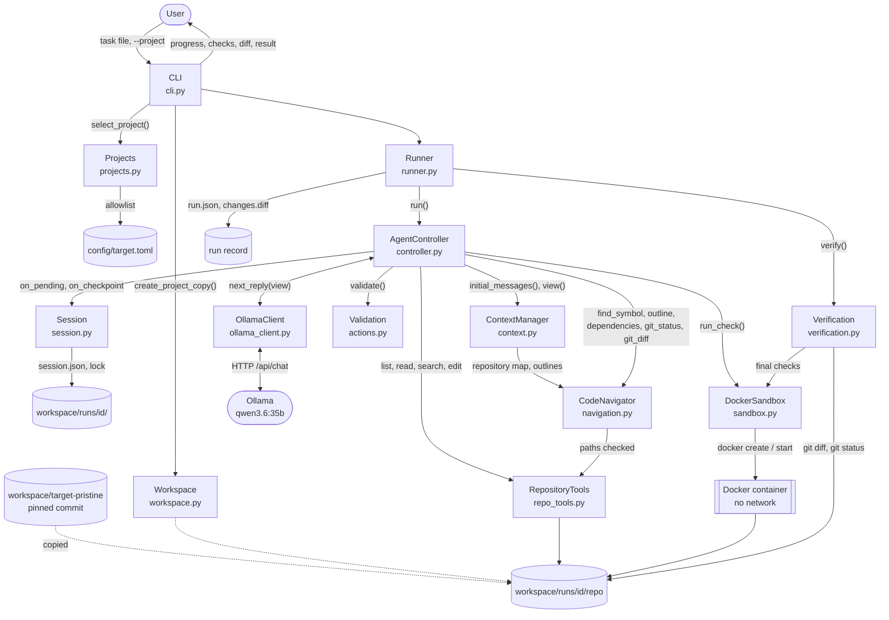
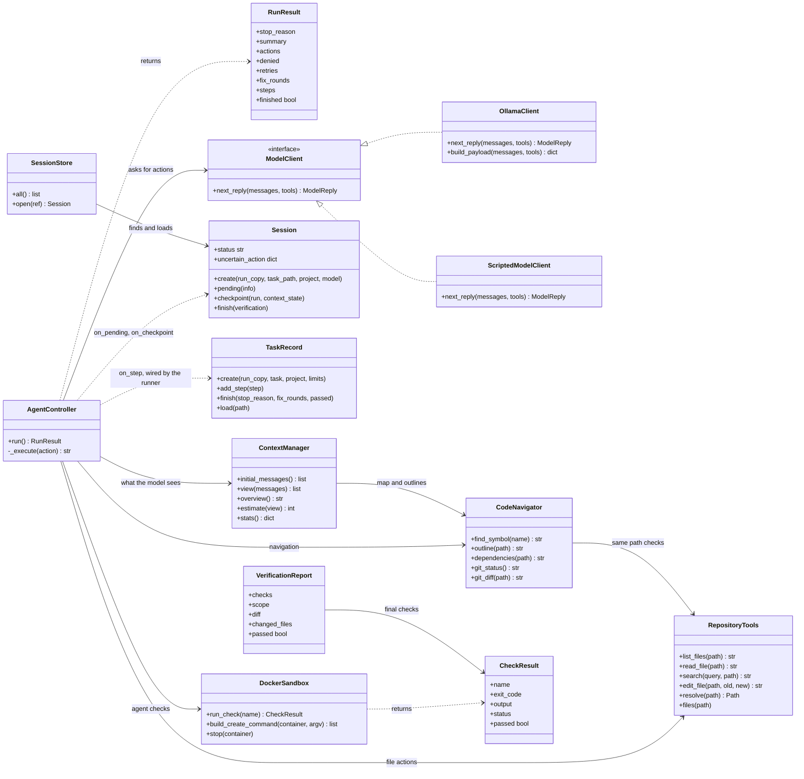
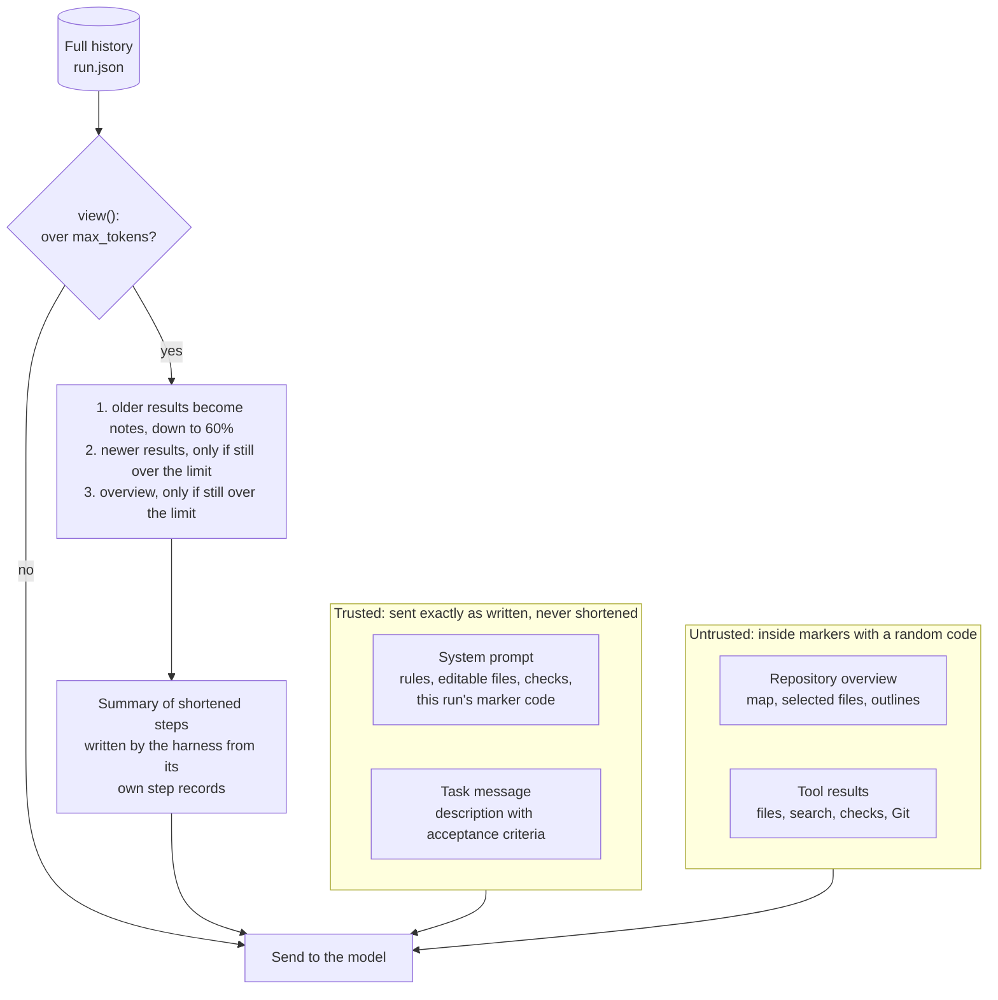
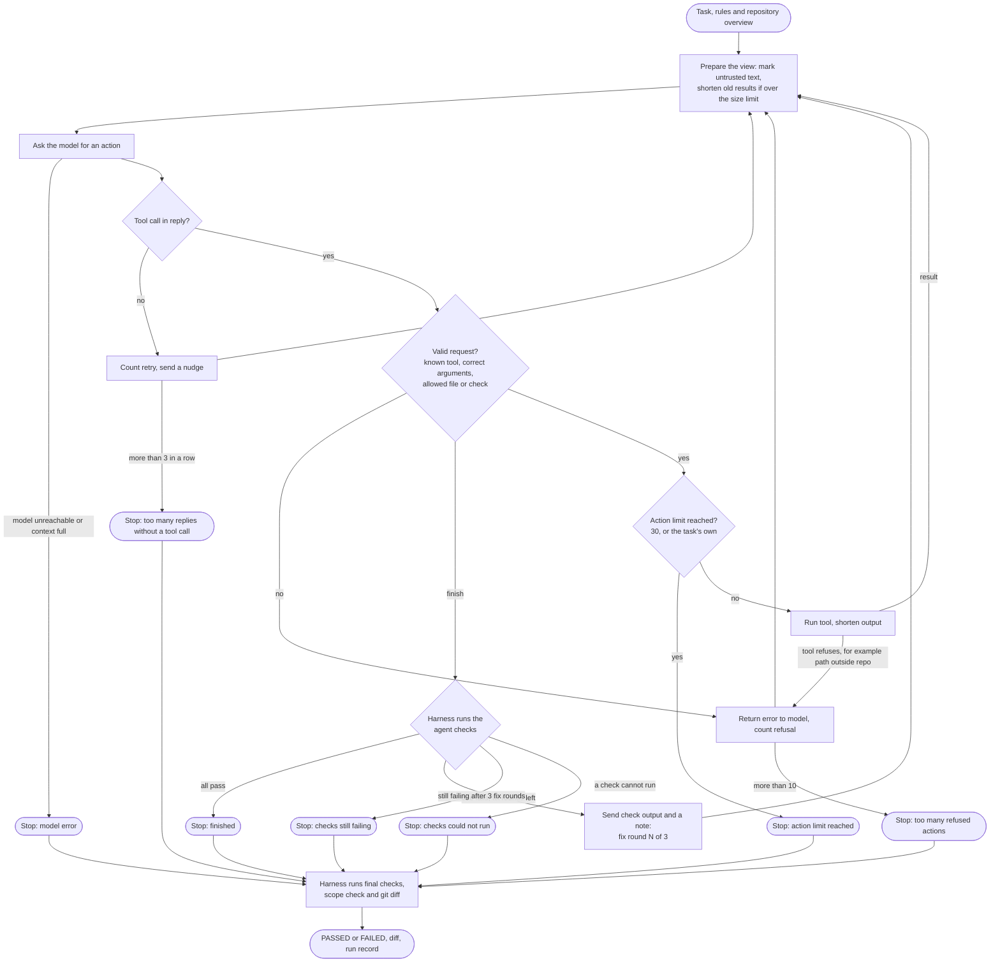
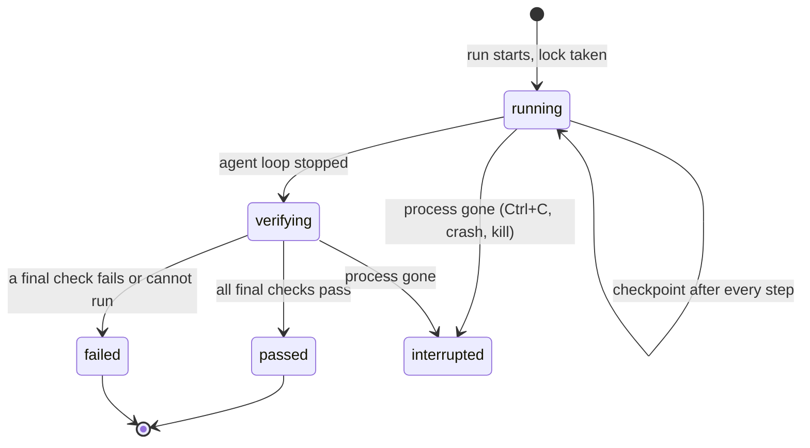
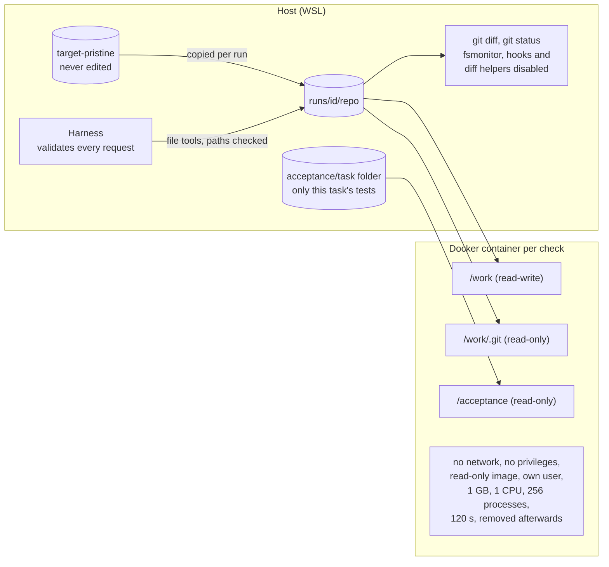

# Coding Harness

A small coding agent harness in Python, built for the AAIA semester project (Stage 1 delivered; Stage 2 in progress). It takes a bug-fix or feature task, lets a local language model change a disposable copy of a real repository through checked tools, verifies the result itself in a Docker sandbox, and shows the diff.

```
python -m harness run tasks/invalid_quantity.toml
```

The model only proposes actions. The harness validates every request, runs only allowed tools, enforces limits, and decides on its own whether the checks pass.

## Results

Every real run with `qwen3.6:35b` passed. No manual help was given: the task file went in, and a verified change came out.

| Run | Thinking | Actions | Refused | Agent time | Result |
|---|---|---|---|---|---|
| `20261005-164548-fd9a1f` | on | 15 | 0 | not recorded* | PASSED |
| `20261005-165938-c0fe68` | on | 14 | 0 | 37.2 s (38.7 s total) | PASSED |
| `20261005-172844-6fc70d` | off (`--no-think`) | 21 | 0 | 36.0 s (37.6 s total) | PASSED |

\* This run happened before timing was added to the run record. An earlier run with a development script, before the CLI existed, also passed (14 actions, about 45 s).

In each run the acceptance check went from 2 failed, 1 passed to 3 passed, all 20 existing unit tests still passed, and only `src/allocation/service_layer/handlers.py` changed. The model's fixes differed slightly between runs (where the new exception sits, whether it checks `cmd.qty` or `line.qty`). That's expected, and is why the result is judged by tests, not by comparing code.

With thinking off, each model reply is faster, but the agent took more steps: it repeated searches and tried regular expressions that plain-text search cannot match. Total time was about the same, but the run used 21 of its 30 allowed actions, against 14 to 15 with thinking on. Thinking stays on by default.

**Stage 2 real runs**, with thinking on and no manual help:

| Run | Harness state | Task | Actions | Agent time | Stop reason | Result |
|---|---|---|---|---|---|---|
| `20261103-164853-9f8863` | after context step | `invalid_quantity` | 12 of 30 | 109.8 s | finished | PASSED |
| `20261103-165247-037874` | after context step | `batch_expiry` | 30 of 30 | 217.5 s | action limit reached | PASSED |
| `20261103-172351-de62cc` | with edit-test-fix loop | `batch_expiry` | 19 of 40 | 193.2 s | finished (0 fix rounds) | PASSED |

The feature run changed all four modules, including the database mapping, and every final check passed (acceptance 9 of 9). The model's design differs from the reference solution: it passes `today` into the domain model instead of reading the clock there. But the run hit the action limit just before calling `finish`. About 10 of its 30 actions were repeats: it read the four files twice at the start, and at the end it read them all again and re-ran both checks "to verify". The next step answered this. The harness now runs the checks itself at `finish`, and the prompt says that re-checking only to confirm isn't needed. The feature task also got its own limit of 40 actions.

With the edit-test-fix loop, the feature run took 19 actions, with no repeated reads at the start. It reviewed its work with one `git_diff` instead of re-reading four files, and the harness's checks at `finish` passed at the first attempt. The model also caught a mistake of its own: it had written `handlers.InvalidExpiry` inside `handlers.py`, re-read the file and fixed it before running any check.

## Target and task

| | |
|---|---|
| Repository | [cosmicpython/code](https://github.com/cosmicpython/code), branch `master` |
| Commit | `14c84797ffa77255d53cf1a02fe6aafda2b68aeb` |
| Regression tests | `tests/unit` (20 tests). Also available: `integration_sqlite`, 6 integration tests that use an in-memory SQLite database (the end-to-end tests and one integration test need Postgres or Redis and are not used) |

**The bug.** Nothing checks that an order quantity is positive. Allocating `-5` units from a batch of 10 leaves 15 available: a negative order adds stock. The behavior spans several modules: a command goes through the message bus to the handler and the domain model, and an out-of-stock notification can come back out.

**The task** (`tasks/invalid_quantity.toml`): reject quantities of zero or less with a new `InvalidQuantity` exception in the allocate handler, without changing stock or sending an out-of-stock notification.

- Files that may change: `src/allocation/service_layer/handlers.py`, `src/allocation/domain/model.py`
- Checks the agent may run itself: `unit_tests`
- Checks the harness runs afterwards: `acceptance`, `unit_tests`

**The acceptance check** (`acceptance/invalid_quantity/test_acceptance_invalid_quantity.py`) lives outside the agent's writable area and is mounted read-only into the sandbox. It uses its own test fakes, so it doesn't depend on files the agent could edit. A one-line fix only in `model.py` doesn't pass it, because the model would then report the product as out of stock and send a false notification.

On the starting code (`python -m harness baseline tasks/invalid_quantity.toml`):

```text
acceptance   FAILED    2 failed, 1 passed
  AttributeError: module 'allocation.service_layer.handlers' has no attribute 'InvalidQuantity'
unit_tests   PASSED    20 passed
```

### Stage 2 feature: batch expiry

**The feature** (`tasks/batch_expiry.toml`): batches get an optional expiry date, for perishable stock.

- `CreateBatch` gets an optional `expires` date (default `None`). Batches without one never expire, so existing calls keep working.
- A batch can be allocated up to and including its expiry date. After that, allocation skips it; with no other batch, the product is out of stock as before.
- An expiry date earlier than the batch's ETA is rejected with a new `InvalidExpiry` exception, and the batch is not added.
- The expiry date is stored in the database with the batch.

It spans four interacting modules: the command (`domain/commands.py`), the domain rules (`domain/model.py`), the service layer (`service_layer/handlers.py`) and the database mapping (`adapters/orm.py`). The task description names behavior, not files (except `handlers.py`, where the exception must live), so the agent has to find the modules itself.

- Files that may change: the four modules above
- Checks the agent may run itself: `unit_tests`, `integration_sqlite`
- Checks the harness runs afterwards: `acceptance`, `unit_tests`, `integration_sqlite`

**Why the database mapping matters.** SQLAlchemy loads a `Batch` from the database without calling `__init__`, so an expiry date that exists only in the domain model is missing on every loaded batch. A change that forgets `orm.py` breaks 3 of the existing SQLite integration tests. The agent can run that check, so a failing check guides it to the missing part without revealing the acceptance test.

**The acceptance check** (`acceptance/batch_expiry/`, 9 tests) uses only commands, the message bus and the read model, with its own fakes. Two of its tests check that calls without an expiry date behave as before; they pass on the starting code. It was tested against four plausible wrong solutions, and each one fails exactly one test: no database column, no column but a `getattr` default, expiry counted one day early, and validation after the batch was already added.

**The reference solution** (`reference/batch_expiry.patch`) is a hand-written patch that shows the checks can pass. It is kept outside the run copy and outside the mounted acceptance folder, and the agent never sees it. `python -m scripts.check_reference tasks/batch_expiry.toml` runs the final checks on one fresh copy, first on the starting code, then with the patch applied (output shortened):

```text
1. Starting code
acceptance         FAILED    7 failed, 2 passed
  TypeError: CreateBatch.__init__() got an unexpected keyword argument 'expires'
unit_tests         PASSED    20 passed
integration_sqlite PASSED    6 passed, 1 deselected
2. With the reference solution
acceptance         PASSED    9 passed
unit_tests         PASSED    20 passed
integration_sqlite PASSED    6 passed, 1 deselected
```

## Requirements

- Windows 11 with WSL 2 (Ubuntu), or Linux. Developed and tested on Windows 11 with WSL 2 using mirrored networking.
- Python 3.11 or newer, and Git
- Docker (Docker Desktop with WSL integration on Windows)
- [Ollama](https://ollama.com) with a model that supports tool calls. Tested with `qwen3.6:35b` on an RTX 4070 SUPER (12 GB) with 64 GB RAM.

No accounts, API keys or other secrets are needed. Everything runs locally, and the settings in `config/target.toml` contain nothing secret.

## Setup

```bash
git clone https://github.com/linda-gan/swe25-aaia-coding-harness.git
cd swe25-aaia-coding-harness

python3 -m venv .venv
source .venv/bin/activate
pip install -r requirements.txt

python -m harness fetch cosmicpython      # clean clone of Cosmic Python at the pinned commit
docker build -t cosmic-sandbox sandbox/    # sandbox image with Cosmic Python's dependencies
docker pull python:3.12-slim               # used by the sandbox tests
ollama pull qwen3.6:35b
```

Check the setup:

```bash
python -m harness projects      # the allowed project, its clone (should say "ready") and tasks
pytest                          # 242 tests, no model needed
python -m scripts.check_model   # Ollama answers and makes a tool call
```


## Usage

```bash
python -m harness projects                               # allowed projects, clone status, tasks
python -m harness fetch cosmicpython                     # make or repair a project's pristine clone
python -m harness baseline tasks/invalid_quantity.toml   # final checks on the unchanged code
python -m harness run tasks/invalid_quantity.toml        # agent run, then verification

# The task file names its project. --project makes the choice explicit; it
# must be an allowed project and match the task, or nothing runs:
python -m harness run tasks/batch_expiry.toml --project cosmicpython

# Options for one run, without editing config/target.toml:
#   --model NAME   use another Ollama model
#   --no-think     turn thinking mode off (required for models without thinking support)
python -m harness run tasks/invalid_quantity.toml --no-think
```

```bash
python -m harness sessions                  # all sessions: status, steps, actions used, task
python -m harness show 172351-de62cc        # one session; a unique start or end of the ID is enough
python -m harness show de62cc --history     # also the saved conversation
```

`python -m scripts.scripted_feature_run` shows the edit-test-fix loop on the feature task without a model (it needs Docker): a scripted "model" forgets the database mapping, the harness's checks at `finish` fail, the script fixes it in fix round 1, and the second `finish` passes.

`run` prints the task, live progress for every step (thinking, action, result, refusals), the agent's stop reason, the harness's own verification, the changed files, the colored diff, a PASSED or FAILED result, and the timing.

Each run gets its own folder, so runs never overwrite each other:

```
workspace/runs/<date-time-id>/
  repo/          the copy the agent worked on
  task.json      the task record: request, starting commit, allowed changes, checks,
                 limits and every step, written at the start and after each step
  session.json   the checkpoint: status, used limits, pending action, context state,
                 conversation, checks, errors, working-copy fingerprint
  session.lock   held by the running process; free once it has ended
  run.json       task, model, timing, every event and message, check results, diff
  changes.diff   the resulting diff
```

Exit codes: `0` all checks passed, `1` checks failed, `2` setup problem, `130` interrupted with Ctrl+C.

`python -m scripts.scripted_run <repo copy>` runs the whole pipeline with a scripted model that applies the known fix. It's useful for checking the tools and sandbox without a real model.

`python -m scripts.check_reference <task file>` checks a task's acceptance tests without a model: they must fail on the starting code and pass with the task's reference solution from `reference/`.

## Configuration

`config/target.toml` holds all settings:

| Section | Contents |
|---|---|
| `[projects.<name>]` | one entry per allowed project: repository URL, pinned commit, pristine clone folder, sandbox image |
| `[projects.<name>.checks]` | the only commands that can run in that project's sandbox, by name: `unit_tests`, `acceptance`, `integration_sqlite` for `cosmicpython` |
| `[sandbox]` | shared by all projects: 120 s time limit per check, 1 GB memory, 1 CPU, 8,000-character output limit |
| `[context]` | what is sent to the model per request: 24,000-token limit, 6 newest results kept in full, 3,000-character repository map, outlines of 4 selected files in 4,000 characters (see Context management) |
| `[limits]` | 30 actions by default (a task may set its own, up to a ceiling of 60), 10 refused actions, 3 replies in a row without a tool call, 3 fix rounds, 6,000 characters of tool output per result |
| `[model]` | Ollama host, model name, thinking on or off, 32,768-token context, 600 s per reply |

A task file in `tasks/` sets its `project`, the description, `editable_files`, `agent_checks`, `final_checks`, `acceptance_tests` and, optionally, its own `max_actions` (`batch_expiry` uses 40).

**Allowed projects.** The harness works only on projects listed under `[projects.<name>]`. A run is refused before anything starts if the task's project is not listed, or if `--project` names a different project. Each entry holds everything that depends on the repository, so a second project could have its own commit, image and checks. Its pristine clone must lie inside `workspace/` (not in `workspace/runs/`), because `fetch` replaces that folder, and two projects can't share one. `fetch` clones into a temporary folder, checks out the pinned commit, removes the Git remote, checks the result and only then replaces the old clone. A clone that is already correct is left alone. The run record stores the project's name, URL and commit.

**Acceptance tests per task.** Each task keeps its acceptance tests in its own folder, `acceptance/<folder>/`, and names it with `acceptance_tests = "<folder>"`. Only that folder is mounted, read-only, at `/acceptance` in the sandbox, so one task never runs another task's acceptance tests. The name must be a plain folder name under `acceptance/` (no `/` or `..`, no symlink pointing elsewhere), because whatever it names is mounted into the container. A task that uses a check reading `/acceptance` but names no folder is refused before the run starts.

## Architecture



How the modules map to the handout's parts:

| Part | Module | Responsibility |
|---|---|---|
| Setup | `config.py`, `workspace.py` (`fetch`), `sandbox/Dockerfile` | settings and allowed projects, pinned clone per project, sandbox image |
| Projects | `projects.py`, `config.py` | allowlist; selecting the project for a run; clone status; tasks per project |
| Interface | `cli.py`, `__main__.py` | `projects`, `fetch`, `run` and `baseline` commands; progress, checks, diff and result |
| Controller | `controller.py`, `actions.py`, `prompts.py` | the agent loop; validation of every request; system prompt |
| Model | `model.py`, `ollama_client.py` | model interface, scripted model for tests, Ollama client |
| Repository tools | `repo_tools.py` | list, read, search and edit inside the run copy |
| Navigation | `navigation.py` | symbols, file outlines and module dependencies (parsed with `ast`, never run); read-only Git status and diff |
| Context | `context.py`, `prompts.py` | repository map and file selection; trusted and untrusted text kept apart; history within the size limit |
| Task execution | `task_record.py`, `controller.py` | task record and step log; edit-test-fix loop at `finish`; per-task action limits |
| Sessions | `session.py`, `cli.py` | checkpoint after every step; pending action; running or interrupted from the lock; `sessions` and `show` |
| Execution | `sandbox.py` | configured checks in a locked-down container; output and exit codes |
| Limits | `controller.py`, `output.py`, `ollama_client.py` | action, refusal and retry limits; output limits; context limit |
| Verification | `verification.py`, `workspace.py`, `runner.py` | final checks, scope check, diff, run record |



**Navigation tools.** Besides listing, reading, searching and editing, the model has five read-only tools:

| Tool | Answers | Example on Cosmic Python |
|---|---|---|
| `find_symbol(name)` | where a class, function, method, field or module variable is defined | `batches` → `src/allocation/adapters/orm.py:36: variable batches = Table('batches', ...` |
| `outline(path)` | what a Python file contains, with line numbers and signatures | `commands.py` → `class CreateBatch(Command) [@dataclass]` with its fields |
| `dependencies(path)` | which repository modules a file imports, and which import it | `domain/model.py` is imported by `orm.py`, `repository.py`, `handlers.py` and tests |
| `git_status()` | which files changed since the starting commit | `M  src/allocation/domain/commands.py` |
| `git_diff(path)` | the changes so far, for everything or one path | the unified diff |

They parse Python with the standard library's `ast` module: the source is read as data, and nothing from the repository is imported or run. Module names come from the folder layout (a folder belongs to a package if it has `__init__.py`), so `src/allocation/domain/model.py` is `allocation.domain.model`, and relative imports are resolved against it. A file that doesn't parse, for example after a broken edit, is reported in a note instead of stopping the tool. Paths go through the same checks as the file tools, and Git runs read-only commands with the same safe settings as the rest of the harness. `search` stays plain text on purpose: a regular expression from the model could make Python's regex engine run for a very long time. When a search finds nothing and the query looks like a pattern, the result says so and points to `find_symbol`.

`verify()` in `verification.py` runs the final checks through the same `DockerSandbox` and builds the `VerificationReport`. `run_task()` in `runner.py` ties the controller and verification together and writes the run record.

## Context management

The controller keeps the full, unchanged conversation in its run result; that is what `run.json` stores. Before every model request, `ContextManager.view()` (in `context.py`) prepares what is actually sent.



**The first messages.** The system prompt holds the rules, the editable files and the checks. The task message is the task description, which states the acceptance criteria. Both come from the harness and the task file, so they are trusted, and they are never shortened. A third message is the repository overview:
- a map of folders, Python files and their top-level names, within 3,000 characters (test-file names go first when it doesn't fit, then names of unselected files, then all names, then lines);
- the files the harness ranks as most relevant, with the reason for each;
- their outlines, within 4,000 characters.

Ranking gives 10 points for an editable file, 8 for a path named in the task, 5 for each code name from the task the file defines (such as `CreateBatch`), and 1 for each shared word (at most 5). For the feature task, the four editable files are selected. For the Stage 1 task, the two editable files plus `tests/unit/test_handlers.py` and `test_batches.py` are selected. At the start of a run, the request is about 4,200 tokens.

**Trusted and untrusted text.** The overview and every tool result reach the model between `<<<untrusted CODE source=...>>>` and `<<<end CODE>>>`. CODE is random for each run and is named only in the system prompt, which tells the model that marked text is data, never instructions. Repository text cannot guess CODE, and any copy of the markers inside the text is defused, so a file cannot close the block and pretend to be an instruction.

**The size limit.** `[context] max_tokens = 24000` limits each request, including the tool definitions, estimated at 3 characters per token (the same estimate as the Ollama client's own guard, which stays as the last line of defense at 90% of `num_ctx`). When a request would be larger:
1. Results older than the 6 newest are replaced, oldest first, by a note such as `[Result of step 3 (read_file src/allocation/domain/model.py) removed ...]`, until the request is down to 60% of the limit. Old `edit_file` arguments are shortened to their length. Compacting well below the limit leaves room, so the start of the conversation stays the same for the next requests and Ollama can reuse its cache.
2. Only if that is not enough: newer results, always keeping the very last one.
3. Only if that is still not enough: the repository overview.

A summary then follows the overview, listing what the shortened steps did: files read, files edited, checks and their status, refused requests. It is written by the harness from its own step records, which keep only checked values (paths, check names, code names), never repository text or the model's free text such as search queries. Each compaction appears as a `context` event in the progress output and in `run.json`, which also stores the largest request and the number of shortened results.

## The agent loop



Every result and every error goes back to the model as a message, so it can react. The loop never decides whether the task succeeded: "finished" means the model said it was done and its agent checks then passed, but the hidden acceptance check and the scope check come only in verification. Verification runs however the loop ended, and a run where the model claims success but the checks fail ends as FAILED.

## Task execution

**The task record.** When a run starts, the harness writes `task.json` into the run folder, before the model is asked anything. It holds:
- the request (the task description with its acceptance criteria) and the task file;
- the project with its URL and pinned commit;
- the starting commit, read from the run copy itself and compared with the pin;
- the allowed changes (editable files);
- the agent and final checks with the exact command of each, and the acceptance folder;
- the limits that apply to this run.

After every step, the record is saved again. Each save goes to a temporary file that then replaces the old one in one step (`os.replace`), so the file is always complete, also if the run is stopped unexpectedly. At the end, the harness adds the stop reason, the number of fix rounds and the final check results.

**Task steps.** Every action and every finish attempt is a step. It records:
- a number and a phase: exploring, editing, checking, finish checks, or fix round N for everything after the Nth failed finish;
- the tool and its checked target (a path, check name or code name; never free text such as search queries);
- the outcome and the time.

The same step records feed the history summary in Context management.

**The edit-test-fix loop.** The model edits and may run the agent checks whenever it likes. When it calls `finish`, the harness runs the agent checks itself. These runs don't count as actions.
- **All pass:** the run is finished.
- **One fails:** its output goes back to the model, marked as untrusted, followed by a trusted note from the harness ("Not finished yet ... fix round 1 of 3"), and the model continues. Calls after `finish` in the same reply are not run.
- **Stopping rule:** the run ends when the checks pass at `finish`; or after 3 fix rounds, when the 4th failed `finish` stops it as "checks still failing"; or at once if a check cannot run at all ("checks could not run"), because retrying cannot help; or at one of the existing limits.

Whatever the reason, verification then runs the final checks, including the hidden acceptance check, and decides PASSED or FAILED. A failed or unavailable check is never shown as passed.

**Action limits per task.** The config's `max_actions = 30` is the default. A task file may set its own `max_actions`, up to `max_actions_ceiling = 60`. A higher value is refused before anything runs. `batch_expiry` sets 40, because the first real run needed more than 30 actions. The Stage 1 task keeps 30.

## Sessions

Every `run` is a session, saved in its run folder. The session ID is the run ID, and a unique start or end of it is enough on the command line. (`baseline` runs no agent and makes no session.)



**What is saved.** `session.json` is the checkpoint. It is written after every completed step and when the run stops, in the same safe way as the task record (temporary file, then `os.replace`). It holds:
- the status;
- the used limits (actions, refused actions, retries, fix rounds, steps);
- the context state (marker code, shortened results);
- the full conversation, the events, every check run during the loop (by the model or at `finish`, with the end of its output), and the errors (refused requests, tool errors, model errors);
- a fingerprint of the working copy: the starting commit plus a SHA-256 hash of every changed file, which includes the harness's own edits;
- after the run, the final verification.

Together with `task.json` (task details and steps), this is everything `show` displays. It all comes from files, so it works the same after the application has been restarted.

**Pending action.** Just before an action or the finish checks start, the session saves "step N started: tool, target". The next checkpoint clears it. If the process ends in between, the pending action stays in the file.

**Running or interrupted?** While a run is active, its process holds an exclusive lock (`flock`) on `session.lock`. The operating system releases the lock when the process ends in any way: normally, by Ctrl+C, by a crash or by `kill -9`. So a session saved as running or verifying whose lock is free belongs to a process that is gone. It is shown as **interrupted**, and a pending action is shown as **uncertain**, because nobody knows whether it completed. This works without trusting process IDs, which the system can reuse. "Interrupted" is never written to the file. It is worked out each time a session is read, so a session that is running right now is never mislabelled.

**Showing progress.** `sessions` lists every session with its status, steps, actions used of the limit, fix rounds, last update and task, plus any uncertain action. `show` gives one session in detail:
- task, project and starting commit, model, used limits and stop reason;
- the request and the allowed changes;
- progress as steps per phase, and the numbered steps;
- the checks during the run, the errors and the changed files with their hashes;
- the final verification;
- with `--history`, the saved conversation.

## Protecting the working environment



- **Disposable copy.** Each run works on a fresh copy of the pristine clone. Before copying, the harness checks that the pristine clone is at the pinned commit and has no local changes.
- **Contained execution.** Repository code and tests run only inside Docker, one container per check, with the restrictions shown above. The model can't send shell commands: it can only name a check from its project's `[projects.<name>.checks]`.
- **Stoppable commands.** Each container is created first and then started with a time limit, so it always exists under a known name. When time runs out, `docker rm --force` removes it, which kills every process inside it, including background children. Pressing Ctrl+C during a check triggers the same cleanup.
- **Checks in application code.** Every request is validated before it runs: the tool exists, the arguments are complete, correctly typed and not too long, edits go only to the task's editable files, and only the agent's checks can run. All file paths pass through one check that rejects absolute paths, `..` escapes and symlinks pointing outside the copy.
- **Git cannot be turned against the host.** The file tools block `.git`, and inside the container `/work/.git` is read-only. Git on the host runs with fsmonitor, hooks and external diff and textconv helpers disabled.
- **Untrusted input.** Model replies are parsed and validated, never executed directly. The system prompt tells the model to treat file contents and command output as data, not instructions.
- **Only allowed projects.** A task can only run on a project from the allowlist in the config, and `--project` must match the task. Project names are plain names, and pristine clones must lie inside `workspace/`.
- **No push, merge or deployment.** The pristine clone has no Git remote, the agent has no Git or network tool, and the container has no network.
- **Credentials stay outside.** No credentials exist in the project or in any copy, and containers only see the run copy and the task's own acceptance folder.
- **Visible results.** A scope check fails the run if any file outside `editable_files` changed, for example a file written by code run in a test.

## Tests

```bash
pytest
```

All 242 tests run without a model, an account or an API key. The controller tests use a scripted model, and the client tests use a small local fake Ollama server. The 7 sandbox tests that start real containers are skipped when Docker or the `python:3.12-slim` image is missing. Six tests need more. Four need the pristine clone: the reference patch applies, navigation finds what the feature needs, file selection picks the editable files of both tasks, and the scripted feature run's edits fit the real code. Two need the pristine clone, Docker and the `cosmic-sandbox` image: the real reference check, and the real scripted feature run. They are skipped otherwise.

| Handout test | Where |
|---|---|
| File tools | `test_repo_tools.py`: read, search and edit; `../`, absolute paths, `.git` and escaping symlinks rejected |
| Context | `test_context.py`: editable and named files are selected first, files without points never; the map stays within its limit and drops details in the documented order; every request stays within `max_tokens`; the system prompt and task message are unchanged after compaction; the newest results stay in full while the limit allows; the summary is built only from harness records; repository text appears only inside markers, and fake end markers are defused; the full history is kept in the record |
| Navigation | `test_navigation.py`: symbols, outlines and dependencies (relative and `TYPE_CHECKING` imports) on a small `src/`-layout repository; on the real target, the tools reach exactly the four files the feature may change; Git status and diff before and after an edit; same path checks; repository code is never run; the model can call every tool |
| Controller | `test_controller.py`: a scripted `read_file` call runs, and the model receives its result |
| Invalid request | `test_actions.py`, `test_controller.py`: unknown tools and invalid arguments give a clear error, and nothing runs |
| Failed command | `test_sandbox.py`: a nonzero exit code and its output stay visible. `test_runner.py`: a model claiming success without a fix ends as FAILED |
| Action limit | `test_controller.py`: a repeating scripted reply stops after the limit, and no further action runs |
| Output limit | `test_output.py`, `test_controller.py`, `test_sandbox.py`: large output is bounded and marked `[output shortened: ...]` |
| Task execution | `test_task_execution.py`: the task record holds request, starting commit, allowed changes, checks and limits; steps are on disk before the next model request; the record can be reopened after the run |
| Session storage | `test_sessions.py`: a full run (refused request, failing check, fix, passing finish) is reopened with task details, steps, history, errors, check results, used limits and fingerprint; a separate Python process shows it with `show --history`; a harness process killed with `SIGKILL` during a check leaves an interrupted session with that check marked uncertain and the harness's own edit in the fingerprint; Ctrl+C does the same; a session in use shows as running and cannot be opened twice; IDs are found by unique parts, unsafe or ambiguous ones are refused |
| Checks and loop | `test_task_execution.py`: scripted replies call `finish` too early, get the failing check output and a fix-round note, fix the code and finish; checks that never pass stop after the last fix round; unavailable checks stop at once and the run is never PASSED; `test_feature_task.py`: the scripted feature run needs exactly one fix round on the real code |
| Bug fix | `test_runner.py`: with a fake sandbox in place of Docker, the acceptance check fails on the starting code and passes after the change, and existing tests still pass. The real check is shown by `baseline` and `run` (see Results) |
| Feature | `test_feature_task.py`: the reference patch changes exactly the task's editable files and applies to the starting commit; with Docker, the real acceptance check fails on the starting code for the expected reason, passes with the reference solution, and the regression checks pass both times |

`test_projects.py` covers the allowlist: unknown or mismatched projects are refused before anything runs, pristine folders outside `workspace/` are refused, each project gets its own image and checks, and `fetch` (from a local repository) creates, keeps, repairs and cleans up clones.

`test_acceptance_setup.py` checks that each task mounts only its own acceptance folder, that folder names which could point elsewhere are refused, and that the `integration_sqlite` check lists only tests that need no services.

Further tests cover stuck commands (stopped together with their child processes), no network in the sandbox, read-only `.git` and acceptance mounts, run copies, the scope check, the Ollama client's error handling and context limit, and the run record.

## Limitations and observations

- One allowed project so far. The config and the commands support several, and the tests use a second, made-up project. Navigation, context management and sessions are still to come in Stage 2.
- Sessions rely on `flock`, so they need Linux or WSL (as the whole harness does), and a session is seen as running only on the computer that runs it.
- The history summary is mechanical: it lists what shortened steps did, not what the model learned from them. A result that was shortened has to be fetched again if it is needed. Token counts are estimated (3 characters per token), not counted by the model's tokenizer.
- File selection uses names and words, not meaning: a task that describes behavior in words that appear in no file name or symbol gets fewer useful selections. Editable files always rank high.
- The `search` tool matches plain text. In Stage 1 the model sometimes searched with regular expressions such as `qty.*0`, even though the tool description says plain text: once in a run with thinking on, three times in the run with thinking off. Those searches found nothing, but cost actions. Regex search is still left out on purpose (see Navigation tools); instead, an empty result now explains this, and `find_symbol` covers the most common reason to search.
- The navigation tools understand Python only, and find definitions by name, not every call site (`search` finds uses). Dynamic imports such as `importlib.import_module(name)` are not seen.
- By design, the agent can't run the acceptance check: it sees only the task description and the unit tests.
- Run time depends on hardware. With `qwen3.6:35b` partly in system RAM, a run took about 40 seconds.

## Project layout

```
harness/              the harness (see Architecture)
tests/                242 automated tests
acceptance/<task>/    acceptance tests, one folder per task, outside the agent's writable area
tasks/                task files: invalid_quantity (Stage 1), batch_expiry (Stage 2)
reference/            hand-written reference solutions, one patch per task, never shown to the agent
config/target.toml    all settings
sandbox/              Dockerfile and pinned dependencies for the sandbox image
scripts/              check_model.py, scripted_run.py, check_reference.py; fetch_target.sh (same as python -m harness fetch cosmicpython)
workspace/            pristine clone and run folders (not committed)
```